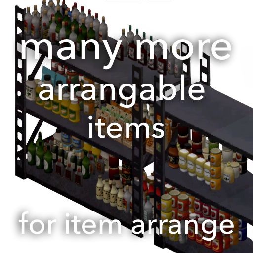

> [!NOTE]
> This repository is a mirror. The mod is developed in a private monorepo, and this copy is updated on every
> release with only the game files and source code. Get the mod on the [Steam Workshop](https://steamcommunity.com/sharedfiles/filedetails/?id=3813943783).
>
> Issues and pull requests are welcome. Pull requests aren't merged here: accepted changes are applied in the
> monorepo with you as the author, show up here with the next release, and the pull request is closed with a
> link to the commit.

---

### _Do you want to spend hours making the perfect pantry and make your PC cry when you zoom out?_
### _Then you've come to the right place._

---

This is an add-on for Slayer's [Item Arrange](https://steamcommunity.com/sharedfiles/filedetails/?id=3767639280). It makes MANY, many more items arrangable, far more surfaces usable and includes some patches:

- Fix ghost items: items are checked to still be there before they're placed
- Shelves above counters (and other stacked furniture on one tile) are all usable
- Items no longer sink into rugs, clip into surfaces or get pushed off when mixing small and large items
- Fix alignment with different wall directions
- Taking an item no longer turns the other items on that tile
- Hold Ctrl to place items side by side instead of stacking them (example usage: buckets, bowls)
- Items that can't be arranged are skipped instead of dropped in a pile (there shouldn't be many of those left)
- Visible highlight when shift+dropping items
- Fix for Project Viewpoint: items actually end up on the tile you point at in 3D view
- Multi-tile furniture (metal shelves, long counters and the like) counts as one linked surface, so items spread across both halves instead of each tile being arranged on its own. Hold Alt while shift+dropping to arrange each tile on its own anyway
- Flatpack furniture (picked-up parts of multi-tile furniture) can be arranged and stacked too
- Performance improvement in multiplayer: only items that actually move get synced, and identical items no longer swap places on every rearrange

### Item orientation

By default, items face away from the nearest wall. Under Options > Mods > Item Arrange Extension you can have them face towards or away from you, or towards or back at where you look. Let me know which one feels best!

### Mixed stacks

Turn on "Mix items with the same model" in the same options to let different items that look the same, such as canned food, share stacks instead of each type getting its own.

### Multi-tile furniture

Turn off "Link multi-tile furniture" in the same options to arrange each tile on its own by default. Holding Alt while shift+dropping always does the opposite of the option.

### Hanging items on wall boards (VERY experimental)

**This is super experimental and barely functional right now.** Expect items to end up in odd spots or not hang at all.

Hang flat items such as guns and tools on cork boards and pegboards: hold Shift and drop exactly on the board, it lights up orange.

### How items get supported

Modded items that reuse a vanilla mesh Item Arrange supports get the same arrangement, so modded ammo boxes, books, bottles, seed packets and the like line up like their vanilla counterparts. For everything else, a script reads all models and surfaces from the game and mods and generates profiles for them, which I then tweak by hand.

If something should stack but doesn't, looks off, clips through or floats above a surface, let me know so I can fix it!

Mods of which most items are supported:

- Authentic Z
- Firearms
- Fools New Containers
- Gael Gun Store
- Guns of Marz
- Pomp's items
- Sapph Cooking
- Vanilla Firearms Extended (VFE)
- Vanilla Foods Expanded (VFX)
